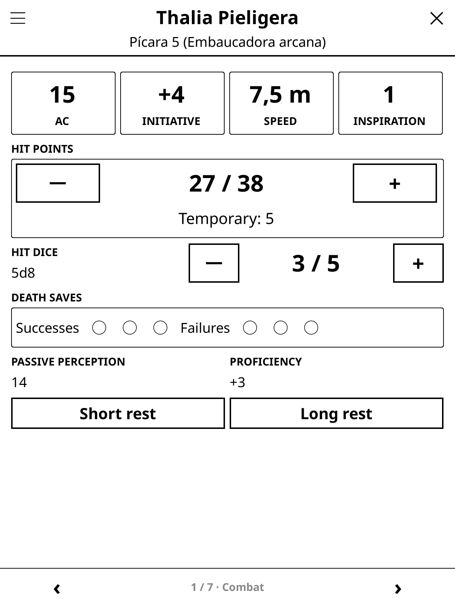
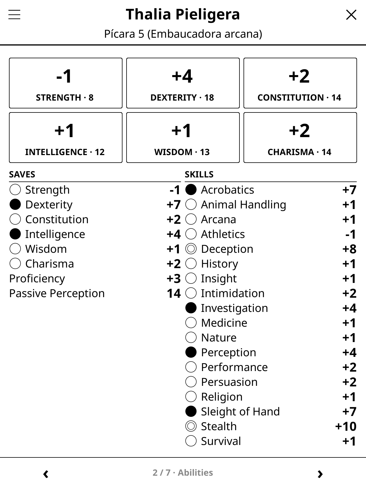
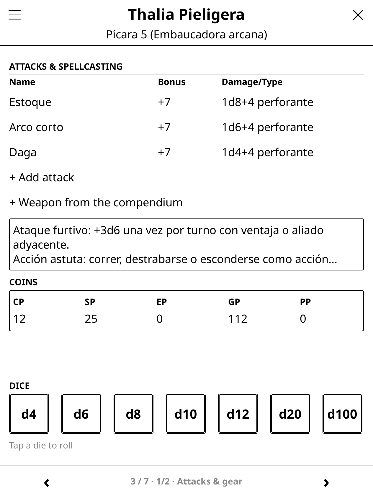
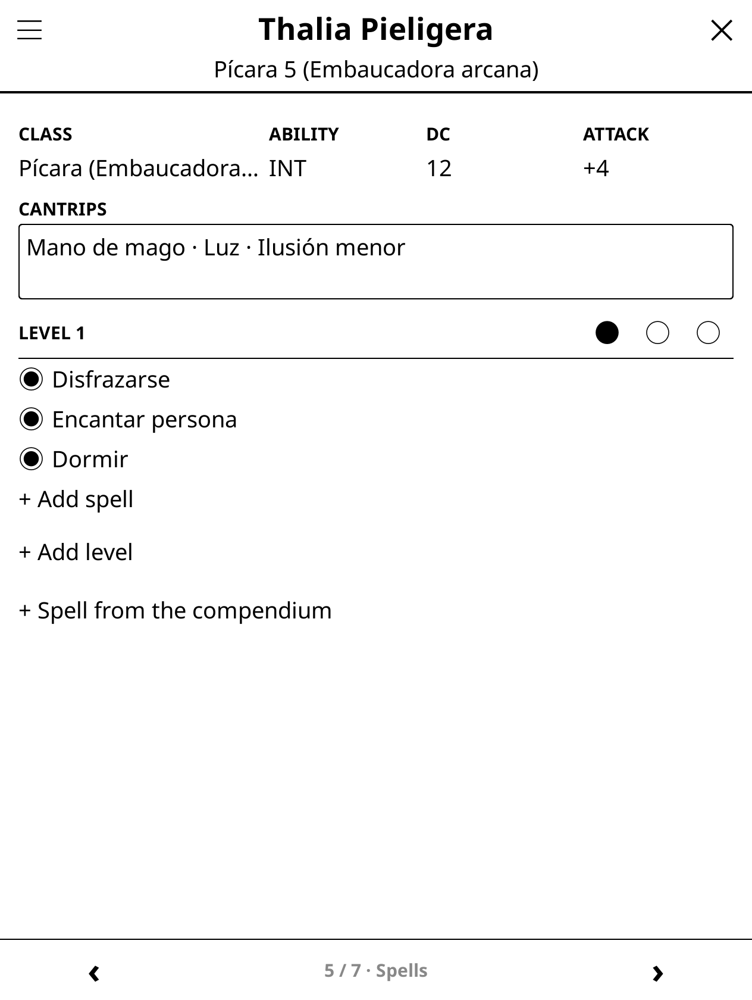
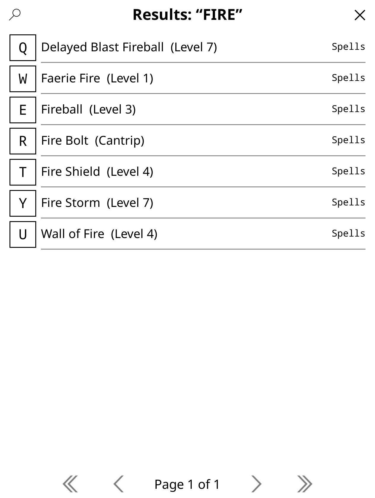
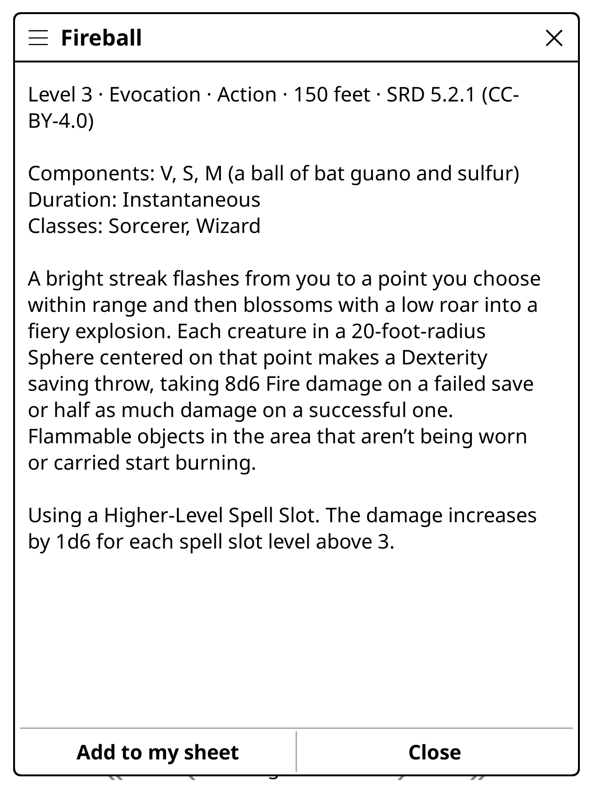

# dndsheet

**Hoja de personaje para [KOReader](https://koreader.rocks), compatible con la 5e (SRD 5.2.1).**
Abrí un archivo `.dnd` en tu lector y obtenés una hoja de 7 páginas pensada para e-ink y pantalla táctil:
botones grandes, sin animaciones salvo una tirada de dados corta, y todo calculado por vos.

> **Estado: beta (0.9.0).** Desarrollado y probado en el emulador de KOReader y en un Kindle Paperwhite
> (12.ª gen) con KOReader v2026.07.1. Algunas funciones recientes esperan la prueba en el aparato
> (ver [Problemas conocidos](#problemas-conocidos)). Kobo, PocketBook y Android: **sin probar**.

  
  
  

  
  
  

## Qué hace

- **7 páginas**: combate · atributos y habilidades · ataques y equipo · rasgos y personalidad · conjuros · trasfondo · notas libres.
- **Cálculo automático**: modificadores, salvaciones, habilidades, iniciativa, percepción pasiva, competencia, CD de conjuros y ataque de conjuros. Tocá un valor derivado para ajustarlo a mano, o volvé a *Automático*.
- **Juego rápido**: HP ±1, daño / curar / HP temporal, salvaciones de muerte, ranuras de conjuros, inspiración, monedas, descanso corto y largo.
- **Bandeja de dados** en la página de ataques (d4 a d100), con una animación corta e historial.
- **Compendio de reglas** (SRD 5.2.1, en inglés): clases, subclases, especies, dotes, 339 conjuros y 38 armas. Buscás por nombre, leés la regla y la pasás a la hoja con **Agregar a mi hoja** (un arma se vuelve un ataque con su bonus y daño). Qué incluye y qué no: [`COBERTURA.md`](COBERTURA.md).
- **Entradas propias**: agregá lo que no está en el SRD con un archivo JSON chico (plantilla en `compendium/plantilla-propia.json`).
- **Varios personajes**: un `.dnd` por personaje; nuevo, duplicar, abrir el último. Guardado seguro (escritura atómica + copia `.bak` del original).
- **Idiomas**: inglés y español, automático o manual; traducir es copiar un archivo ([`docs/TRADUCIR.md`](docs/TRADUCIR.md)).
- **Formato abierto**: un `.dnd` es JSON de texto que podés leer, editar o generar ([`docs/FORMATO-DND.md`](docs/FORMATO-DND.md)).

## Instalación

Necesitás [KOReader](https://koreader.rocks) ya funcionando en el aparato (este plugin no lo instala).

1. Bajá `dndsheet-<versión>.zip` de la [última release](../../releases).
2. Descomprimilo: queda una carpeta llamada **`dndsheet.koplugin`**.
3. Copiá esa carpeta a la carpeta `plugins` de KOReader (debe existir `…/plugins/dndsheet.koplugin/main.lua`):

| Aparato | Dónde está `plugins/` | Estado |
|---|---|---|
| Kindle | `koreader/plugins/` (por USB; `/mnt/us/koreader/plugins/` en el aparato) | probado |
| Kobo | `.adds/koreader/plugins/` (carpeta oculta: activá "mostrar archivos ocultos") | **sin probar** |
| PocketBook | `applications/koreader/plugins/` | **sin probar** |
| Android | `koreader/plugins/` dentro de la carpeta de KOReader que elegiste | **sin probar** |

4. Reiniciá KOReader (⚙ → Dispositivo → Reiniciar KOReader, o reiniciá el aparato).
5. Comprobá en ⚙ → *Más herramientas* → *Gestión de plugins* que **dndsheet** figura y está activado.

Verificá la descarga con `sha256sum -c SHA256SUMS`.

*Alternativa:* si usás el plugin comunitario [App Store](https://github.com/omer-faruq/appstore.koplugin), podés instalarlo con la URL de este repositorio.

## Primeros pasos

1. Menú superior (tocá arriba de la pantalla) → 🔧 herramientas → **dndsheet** → **Nuevo personaje…** y escribí el nombre.
2. Se abre la hoja. Deslizá ← / → para cambiar de página (da la vuelta), o tocá `n / 7` para ir a una.
3. Tocá un valor para editarlo. Se guarda solo un momento después, al cerrar y al suspender.
4. Tocá ✕ (o deslizá hacia abajo desde el título) para cerrar. Los personajes están en `documents/dnd/` (configurable); cualquier `.dnd` del explorador abre la hoja.

Menú **≡**: ir a página, descansos, duplicar personaje, refrescar pantalla, ver archivo, **Compendio**, cerrar.

### Usar el compendio
≡ → **Compendio** → elegí una lista (clases, conjuros…) o usá 🔍. Abrí una entrada y tocá **Agregar a mi hoja**.
También están los botones **+ Desde el compendio** en las páginas 3, 4 y 5.
Para lo que no está en el SRD (por ejemplo, especies de otros libros): copiá `compendium/plantilla-propia.json`
a `<carpeta de personajes>/compendio/`, renombralo y completalo con tu propio texto.

## Compatibilidad

- **KOReader v2026.07.1** es la versión probada. Versiones anteriores o posteriores: sin garantía.
- **SimpleUI** (plugin que reemplaza la pantalla de inicio): contemplado, la hoja vuelve al despertar el aparato. Falta verificarlo en el aparato.
- Un `.dnd` guardado por un dndsheet *más nuevo* se abre en solo lectura con un aviso, para no dañarlo.

## Problemas conocidos

- El compendio está solo en inglés por ahora.
- Pendientes de prueba en el Kindle: animación de dados, editor de monedas con SimpleUI, tiempos del compendio.
- Las reglas que el SRD no contiene (casi todo el Player's Handbook) no están incluidas ni lo van a estar: usá *entradas propias*.

## Reportar un problema

Abrí un [issue](../../issues) con: versión de dndsheet (*Acerca de*), versión de KOReader, aparato, pasos para reproducirlo
y las líneas con `dndsheet` de `koreader/crash.log` (antes activá ⚙ → Desarrollador → *Activar registro de depuración*).
Es un proyecto personal: no hay plazos de soporte, pero los reportes se leen.

## Contribuir

Ver [`CONTRIBUTING.md`](CONTRIBUTING.md). Las PR no pueden incluir texto del Player's Handbook ni de otros libros fuera del SRD.

## Licencia

- Código: [AGPL-3.0-or-later](LICENSE).
- Datos de reglas en `compendium/srd521/`: System Reference Document 5.2.1 de Wizards of the Coast LLC, CC-BY-4.0.

> This work includes material from the System Reference Document 5.2.1 (“SRD 5.2.1”) by Wizards of the Coast LLC, available at https://www.dndbeyond.com/srd. The SRD 5.2.1 is licensed under the Creative Commons Attribution 4.0 International License, available at https://creativecommons.org/licenses/by/4.0/legalcode.

dndsheet no está afiliado a Wizards of the Coast. "Dungeons & Dragons" y "D&D" son marcas de Wizards of the Coast LLC. Ver [`NOTICE.md`](NOTICE.md).

English: [README.md](README.md)
