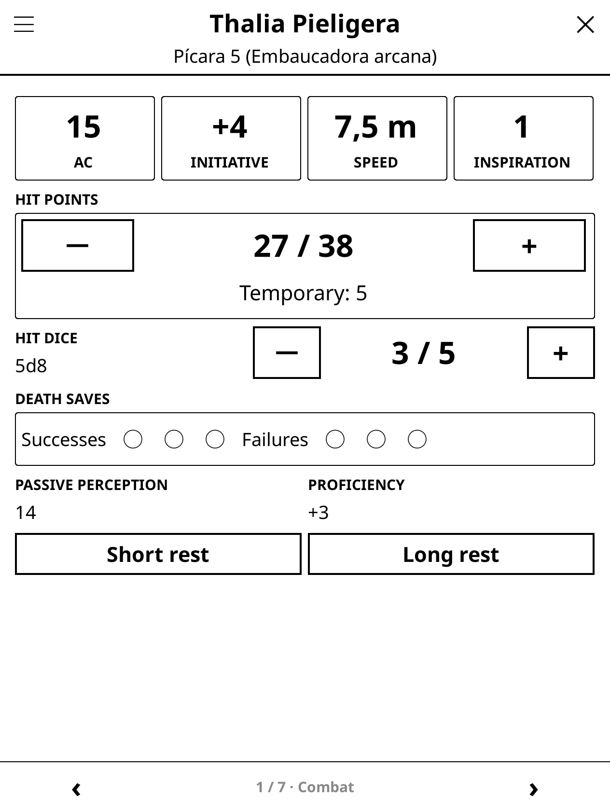
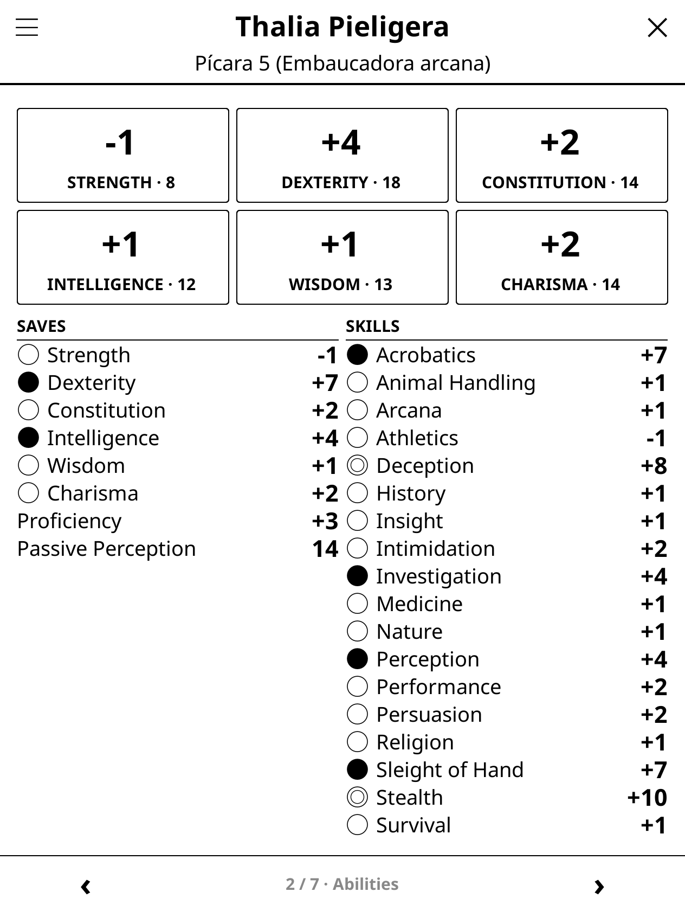
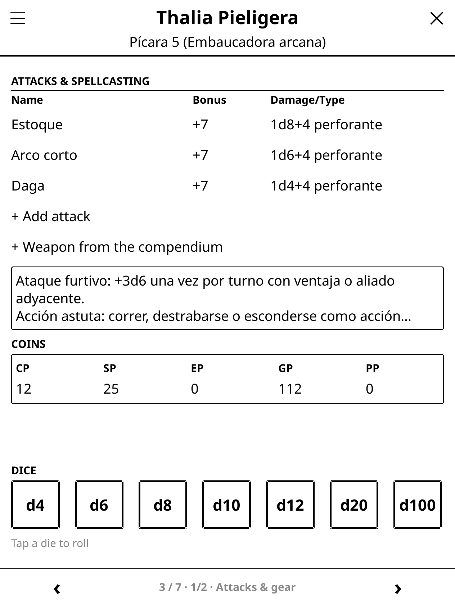
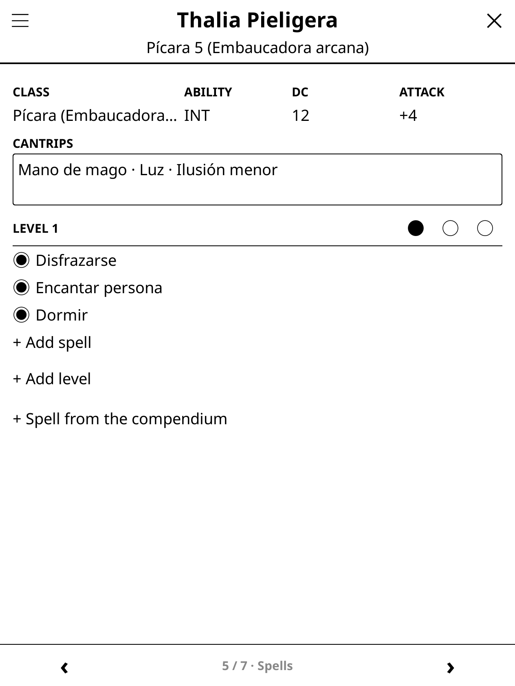
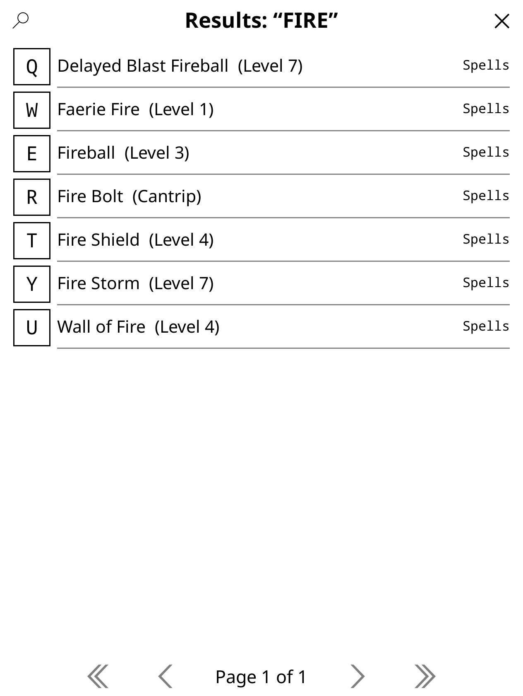
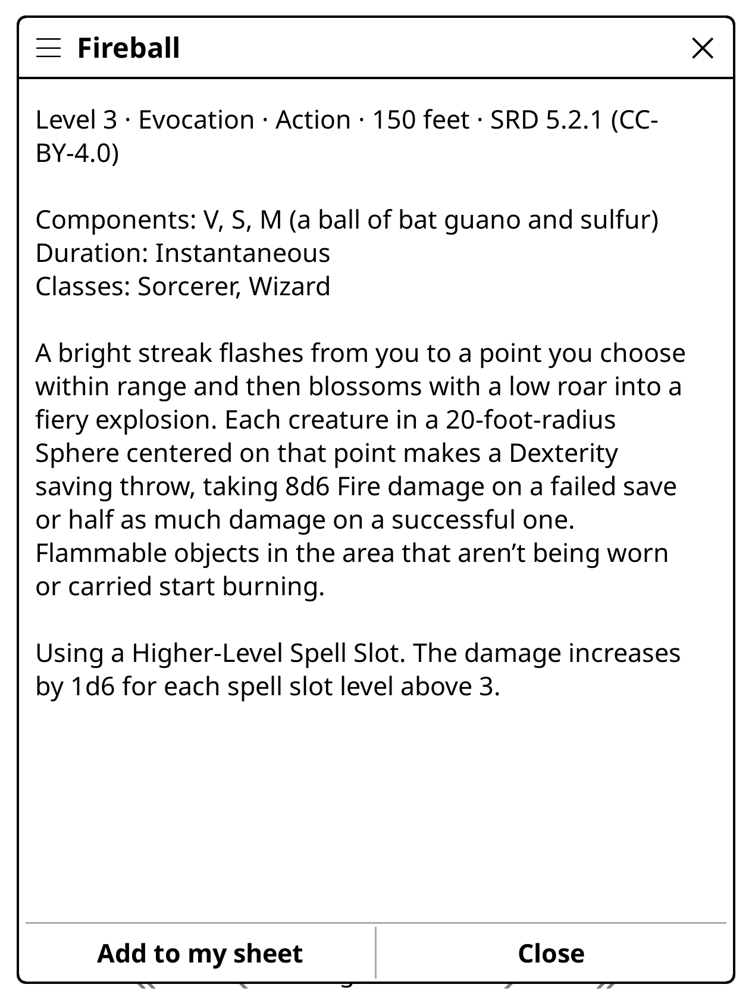

# dndsheet

**A character sheet for [KOReader](https://koreader.rocks), compatible with 5e (SRD 5.2.1).**
Open a `.dnd` file on your e-reader and get a 7-page character sheet built for e-ink and touch:
big tap targets, no animations on the screen except a short dice roll, and everything calculated for you.

> **Status: beta (0.9.0).** Developed and tested in the KOReader emulator and on a Kindle Paperwhite
> (12th gen) with KOReader v2026.07.1. Some recent features are still waiting for a hardware check
> (see [Known issues](#known-issues)). Kobo, PocketBook and Android are **untested**.

  
  
  

  
  
  

## Features

- **7 pages**: combat · abilities & skills · attacks & equipment · features & personality · spells · background · free notes.
- **Calculated for you**: modifiers, saves, skills, initiative, passive Perception, proficiency bonus, spell save DC and spell attack. Tap any derived value to override it, or go back to *Automatic*.
- **Quick play**: HP ±1, damage/heal/temporary HP, death saves, spell slots, inspiration, coins, short and long rest.
- **Dice tray** on the attacks page (d4 to d100) with a short roll animation and history.
- **Rules compendium** (SRD 5.2.1, English): classes, subclasses, species, feats, 339 spells and 38 weapons. Search by name, read the rule on the sheet and **Add to my sheet** (a weapon becomes a ready attack with its bonus and damage). What is and is not included: [`COBERTURA.md`](COBERTURA.md).
- **Your own entries**: add anything outside the SRD with a small JSON file (template in `compendium/plantilla-propia.json`).
- **Several characters**: one `.dnd` file each; new, duplicate, open last. Safe saving (atomic write + `.bak` copy of the original).
- **Languages**: English and Spanish, automatic or manual; translating is copying one file ([`docs/TRADUCIR.md`](docs/TRADUCIR.md)).
- **Open format**: a `.dnd` is plain JSON you can read, edit or generate ([`docs/FORMATO-DND.md`](docs/FORMATO-DND.md)).

## Install

You need [KOReader](https://koreader.rocks) already running on your device (this plugin does not install it).

1. Download `dndsheet-<version>.zip` from the [latest release](../../releases).
2. Unzip it. You get a folder named **`dndsheet.koplugin`**.
3. Copy that folder into KOReader's `plugins` folder (so that `…/plugins/dndsheet.koplugin/main.lua` exists):

| Device | Where `plugins/` is | Status |
|---|---|---|
| Kindle | `koreader/plugins/` (over USB; `/mnt/us/koreader/plugins/` on the device) | tested |
| Kobo | `.adds/koreader/plugins/` (hidden folder; enable "show hidden files") | **untested** |
| PocketBook | `applications/koreader/plugins/` | **untested** |
| Android | `koreader/plugins/` in the KOReader folder you chose | **untested** |

4. Restart KOReader (⚙ → Device → Restart KOReader, or reboot the device).
5. Check ⚙ → *More tools* → *Plugin management*: **dndsheet** should be listed and enabled.

Verify the download with `sha256sum -c SHA256SUMS`.

*Alternative:* if you use the community [App Store plugin](https://github.com/omer-faruq/appstore.koplugin), you can install it from this repository's URL.

## First steps

1. Open the top menu (tap the top of the screen) → 🔧 tools → **dndsheet** → **New character…**, type a name.
2. The sheet opens. Swipe ← / → to change page (it wraps around), or tap `n / 7` to jump to a page.
3. Tap a value to edit it. Changes are saved automatically a moment later, on close and on suspend.
4. Tap ✕ (or swipe down from the title) to close. Characters live in `documents/dnd/` (configurable); any `.dnd` file in the file browser opens the sheet.

Menu **≡**: go to page, rests, duplicate character, refresh screen, view file, **Compendium**, close.

### Using the compendium
≡ → **Compendium** → pick a list (classes, spells…) or use 🔍. Open an entry and tap **Add to my sheet**.
You can also use the **+ From the compendium** buttons on pages 3, 4 and 5.
Entries that are not in the SRD (for example, species from other books): copy `compendium/plantilla-propia.json`
to `<characters folder>/compendio/`, rename it and fill in your own text.

## Compatibility

- **KOReader v2026.07.1** is the tested version. Older or newer versions: no guarantee.
- **SimpleUI** (plugin that replaces the home screen): handled, the sheet comes back after waking the device. Hardware verification is pending.
- A `.dnd` saved by a *newer* dndsheet opens read-only with a warning, so it is never damaged.

## Known issues

- The compendium is English only for now.
- Pending hardware checks on the Kindle: dice animation, coin editor with SimpleUI, compendium on-device timing.
- Rules the SRD does not contain (most of the Player's Handbook) are not included, and never will be here: use *your own entries*.

## Reporting a problem

Open an [issue](../../issues) and include: dndsheet version (*About*), KOReader version, device, the steps to reproduce,
and the lines containing `dndsheet` from `koreader/crash.log` (enable ⚙ → Developer options → *Enable debug logging* first).
This is a hobby project: there is no support schedule, but reports are read.

## Contributing

See [`CONTRIBUTING.md`](CONTRIBUTING.md). Pull requests must not contain text from the Player's Handbook or any non-SRD book.

## License

- Code: [AGPL-3.0-or-later](LICENSE).
- Rules data in `compendium/srd521/`: System Reference Document 5.2.1 by Wizards of the Coast LLC, CC-BY-4.0.

> This work includes material from the System Reference Document 5.2.1 (“SRD 5.2.1”) by Wizards of the Coast LLC, available at https://www.dndbeyond.com/srd. The SRD 5.2.1 is licensed under the Creative Commons Attribution 4.0 International License, available at https://creativecommons.org/licenses/by/4.0/legalcode.

dndsheet is not affiliated with Wizards of the Coast. "Dungeons & Dragons" and "D&D" are trademarks of Wizards of the Coast LLC. See [`NOTICE.md`](NOTICE.md).

Español: [README.es.md](README.es.md)
